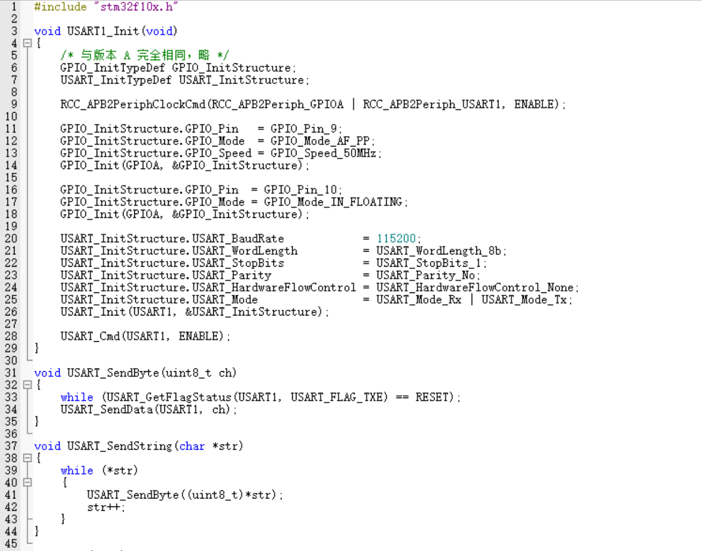
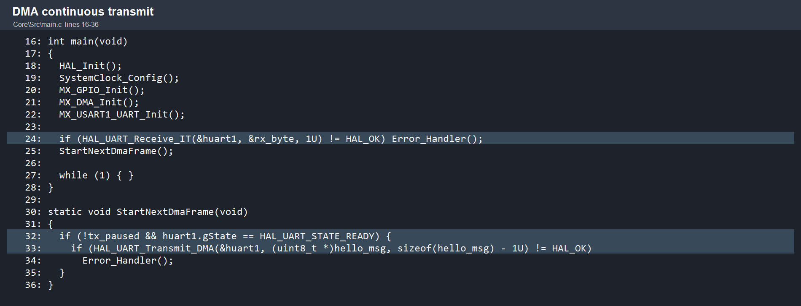
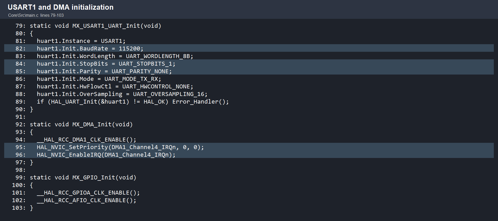
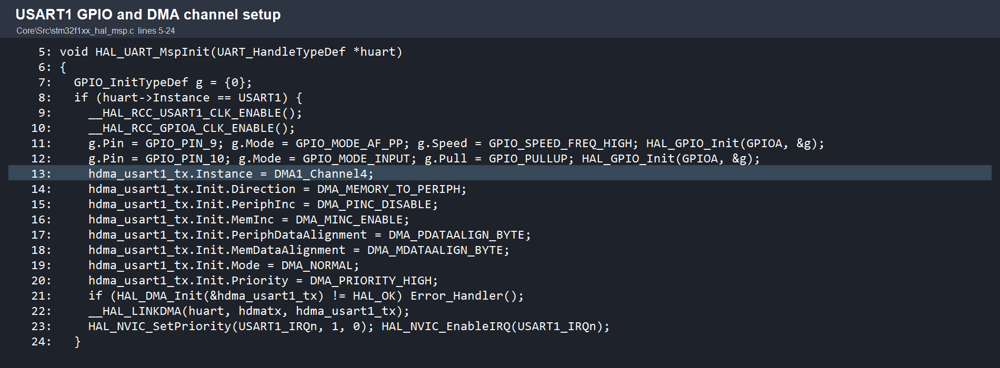
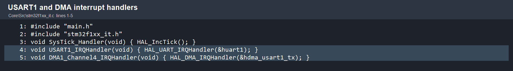
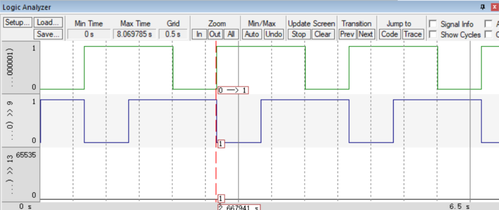

# 嵌入式基础实验 2：串口、USART 中断与 DMA 综合实验报告

> **实验类型**：串口基础与 STM32 USART 综合实验  
> **实验平台**：STM32F103C8T6（USART1，PA9/PA10）、Windows 10、USB/TTL 转 RS232 模块、串口助手、Keil MDK、STM32CubeMX  
> **串口参数**：115200 bit/s，8 数据位，1 停止位，无校验，无硬件流控（8N1）  
> **素材说明**：本报告引用的原始截图和视频已按正文首次出现的顺序重新编号，位于 `报告素材` 文件夹；同一组编号的副本也位于 `D:\新建文件夹 (2)\文件\个人文件\作业\嵌入式基础\作业三`。

## 摘要

本实验围绕异步串行通信完成三部分工作。第一部分学习 UART/RS-232/RS-485/TTL 电平及 CH340 类 USB 串口模块的工作原理，并搭建两台笔记本之间的串口文件传输链路。第二部分使用 STM32CubeMX、Keil 和 HAL/标准外设库配置 USART1，在 115200 bit/s 下连续发送 `hello windows!`，比较无延时轮询发送、接收中断暂停/恢复和 DMA 连续发送三种实现。第三部分使用 Keil uVision 的软件仿真 Logic Analyzer 观察 USART 输出时序，按照起始位、数据位和停止位解释波形，并给出波特率测量方法。

实验表明：只要发送函数在写入下一个字节前等待发送数据寄存器空（TXE），轮询方式即使不显式加入延时也不会因为 CPU 写得太快而破坏 UART 帧；上位机显示速度、串口助手缓存和 USB 驱动仍可能造成“看起来丢字节”。接收中断适合处理 `#`/`*` 控制命令，DMA 适合连续大块发送，可显著减少 CPU 逐字节参与。实际链路中，TX/RX 必须交叉，且应连接公共 GND；不接地时偶尔能工作的现象通常来自 USB 屏蔽层、保护器件或寄生电容形成的非确定性回流，不应作为可靠接线方案。

## 1. 实验目标与安全说明

### 1.1 实验目标

1. 理解 UART 异步帧结构、RS-232、RS-485 与 TTL 电平的差异。
2. 理解 CH340 USB-UART 芯片和 RS-232 电平转换器的分工。
3. 建立两台电脑之间的串口文件传输链路，估算文件大小、波特率和传输时间的关系，并用秒表或串口助手日志比较实际时间。
4. 使用 CubeMX/Keil 完成 USART1 115200、8N1 配置，验证连续输出与 `#` 暂停、`*` 恢复。
5. 用接收中断实现命令控制，用 TX DMA 实现连续发送。
6. 用 Logic Analyzer 检查 UART 波形状态和实际波特率。

### 1.2 电气安全与接线原则

- 本实验默认 STM32 和 USB 串口模块为 3.3 V TTL 侧；不要把 5 V TTL 直接接到只容忍 3.3 V 的 GPIO。
- “USB/TTL 转 RS232”模块的 RS-232 端不能直接接 STM32 PA9/PA10；STM32 端应接模块的 TTL 端，若必须接真正的 RS-232 接口，需要使用 MAX232/MAX3232 一类电平收发器。
- 上电前确认 TX/RX 没有反接到同名端，确认所有设备电压等级一致。
- RS-232 输出可能达到正负数伏甚至更高幅值，不能用普通示波器探头或单片机 GPIO 直接承受。

## 2. 基础一：串口协议、电平标准与 CH340 模块

### 2.1 UART 异步串行帧

UART 没有单独的时钟线，发送端和接收端预先约定波特率、数据位数、校验方式和停止位。典型 8N1 帧如下：

```text
空闲(1) | 起始位(0) | D0 D1 D2 D3 D4 D5 D6 D7（低位先发） | 停止位(1)
```

8N1 每个有效数据字节占用 1 个起始位 + 8 个数据位 + 1 个停止位，共 10 bit。因此在不考虑协议包头、应答和空闲间隔时：

\[
R_{byte} \approx \frac{B}{10}, \qquad
t \approx \frac{S\times 10}{B}
\]

其中 `B` 为波特率（bit/s），`S` 为文件字节数，`t` 为理论秒数。115200 bit/s、8N1 的理想有效吞吐约为 11520 byte/s，即约 11.25 KiB/s（十进制约 11.52 kB/s）。

### 2.2 RS-232、RS-485 与 TTL 的区别

| 项目 | TTL UART | RS-232 | RS-485 |
|---|---|---|---|
| 信号形式 | 单端、相对本地 GND | 单端、相对本地 GND，但采用较大的正负电压 | 差分 A/B 两线 |
| 典型逻辑电平 | 3.3 V 或 5 V；高电平接近 VCC | 接收端通常把低于约 -3 V 和高于约 +3 V 作为有效区，具体阈值依器件而定 | 由 A-B 差分电压判定，抗共模干扰能力强 |
| 连接方式 | TX 对 RX，通常需要共地 | TX 对 RX，通常需要共地 | 半双工总线常用 A 对 A、B 对 B，并在总线两端端接 |
| 典型距离/节点 | 板内或短线、点对点 | 点对点，短距离 | 较长距离、多节点、工业现场 |
| 收发器 | MCU UART GPIO | MAX232/MAX3232 等 | MAX485、SN65HVD 等 |

关键结论是：**TTL、RS-232、RS-485 不是同一种电平，只是都可以承载异步串行协议。** 同样的“115200、8N1”协议参数不能消除电气接口不兼容问题。

### 2.3 CH340“USB/TTL 转 232”模块的工作原理

CH340 是 USB-UART 桥接芯片，负责 USB 枚举、USB 数据包与 UART 的 TXD/RXD 字节流转换。常见模块有两种结构：

1. **USB/TTL 模块**：CH340 直接输出 3.3 V/5 V TTL UART，端子一般标注 `TXD、RXD、GND、VCC`。
2. **USB/TTL 转 RS-232 模块**：在 CH340 后面再增加 MAX232/MAX3232 等电荷泵/电平转换器，经过 RS-232 收发器后才得到正负摆幅的 RS-232 信号。模块上标注的“232”通常指这个第二级电平转换，而不是 CH340 自身产生 RS-232 电平。

发送方向的数据流为：

```text
Windows USB 驱动 → USB 包 → CH340 → TTL UART → MAX232/MAX3232（如有）→ RS-232 线
```

接收方向则反向经过 RS-232 接收器和 CH340，最终在 Windows 中显示为虚拟串口 `COMx`。因此排查故障时要分层检查：Windows 是否识别 COM 口、CH340 驱动是否正常、TTL 侧是否有 UART 波形、RS-232 侧电平是否正确、两端参数是否一致。

## 3. 基础二：两台电脑串口传输文件

### 3.1 硬件连接

两台电脑各连接一个 USB/TTL 转 RS232 模块。若使用模块的 TTL 端进行实验，建议连接如下：

```text
电脑 A 模块 TXD  ─────────→ 电脑 B 模块 RXD
电脑 A 模块 RXD  ←───────── 电脑 B 模块 TXD
电脑 A 模块 GND  ────────── 电脑 B 模块 GND
```

两端模块分别由各自电脑 USB 口供电；不要把两个模块的 VCC 随意并接。打开设备管理器确认两个虚拟串口号，再在串口助手中设置一致的 115200、8、N、1 参数。

### 3.2 串口助手操作流程

1. 在接收端打开串口，选择正确的 COM 号和 115200/8N1。
2. 在发送端打开串口，先发送短文本确认 TX/RX/GND 接线正确。
3. 进入串口助手的“协议传输/文件传输”页面，选择图片、视频或压缩包等二进制文件。
4. 发送前清空接收窗口并记录系统时间；传输结束后保存接收文件。
5. 对比原文件和接收文件的字节数、MD5/SHA-256，并用秒表记录从点击“发送”到提示完成的时间。
6. 对大文件应关闭无关串口输出，避免把调试文本混入二进制文件；如果软件支持 XMODEM/YMODEM/ZMODEM，应优先使用带校验和重传的协议。

### 3.3 理论时间估算

在 8N1、无额外协议开销的理想情况下，按二进制 MiB 计算：

| 文件大小 | 115200 bit/s 理论时间 | 460800 bit/s 理论时间 | 921600 bit/s 理论时间 |
|---:|---:|---:|---:|
| 5 MiB | 7.58 min | 1.90 min | 0.95 min |
| 50 MiB | 75.85 min | 18.96 min | 9.48 min |
| 200 MiB | 5.06 h | 1.26 h | 37.93 min |
| 1 GiB | 25.91 h | 6.48 h | 3.24 h |

实际时间应大于或等于理论值，因为文件传输通常还包含包头、长度、序号、校验、ACK/NAK、超时重传和软件缓冲刷新。可用效率估算：

\[
\eta=\frac{t_{ideal}}{t_{actual}},\qquad
t_{actual}\approx\frac{S\times 10}{B\times\eta}
\]

当串口助手显示的平均有效效率约为 80%～95% 时，115200 bit/s 的实际吞吐约为 9.2～11.0 kB/s。若实测明显低于该范围，应检查协议是否启用了逐包等待、发送间隔、流控或重传。

> **实测数据说明**：本次提供的原始素材包含串口助手运行视频，但没有包含“文件发送开始/结束时间”或接收文件校验值截图。因此这里给出可复现的计算和记录方法，不把理论时间冒充为实测值。完成现场发送后，将 `文件大小、波特率、开始时刻、结束时刻、实际秒数、接收文件哈希` 填入下表即可直接用于博客。

| 文件 | 大小（字节） | 波特率 | 理论时间 | 实测时间 | 效率 `理论/实测` | 校验结果 |
|---|---:|---:|---:|---:|---:|---|
| 图片/视频/压缩包（现场填写） |  | 115200 | `S×10/115200` |  |  |  |

### 3.4 TX/RX 两根线、不接电源或 GND 能否工作？

结论是：**有时会短暂显示数据，但不能认为能正常、可靠地工作。** 原因分三层：

1. 两个 USB 模块通常已经由各自电脑 USB 口供电，所以“模块电源”可能仍然存在；但信号电压必须相对于接收端参考地解释，TX/RX 之间没有公共参考时，输入阈值没有确定基准。
2. 实际系统中可能通过 USB 屏蔽层、电脑保护地、接口保护二极管、线缆电容或其他外设形成微小回流，于是低速、短线时看起来还能收到数据。这是寄生路径，不是协议保证。
3. 没有 GND 时，共模电压可能超出收发器输入范围，导致随机乱码、帧错误、丢包，甚至通过保护结构反向供电。RS-232 的正负电平尤其需要稳定参考；RS-485 虽为差分，也需要在允许的共模范围内建立参考和屏蔽。

因此实验报告中的规范接法应始终包含 **TX↔RX、RX↔TX、GND↔GND**；若使用真正的 RS-232 接口，还要保证两端均经过正确的 RS-232 收发器，不能直接把 TTL 接到 RS-232 电平线上。

### 3.5 文件传输证据

下面的视频是本实验素材中的串口助手运行记录，可用于博客展示串口参数、接收窗口和操作过程。Markdown 页面中可直接播放；PDF 中以“视频证据”文字提示代替可交互播放。

<video controls width="900" src="报告素材/6.mp4">视频 6：串口助手运行记录</video>

## 4. 任务一：USART1 轮询发送与 `#`/`*` 控制

### 4.1 CubeMX 与 Keil 建工程

1. 安装 STM32CubeMX、Keil MDK 和对应 STM32F1 设备支持包；安装完成后分别启动一次确认路径可用。
2. CubeMX 新建 STM32F103C8Tx 工程，选择 `USART1` 为 Asynchronous，PA9 设为 TX，PA10 设为 RX。
3. 在 USART1 参数中设置 Baud Rate=115200、Word Length=8 Bits、Parity=None、Stop Bits=1、Hardware Flow Control=None、Mode=TX/RX。
4. 在 Project Manager 中选择 MDK-ARM V5，勾选生成初始化代码并保留用户代码区，点击 Generate Code 后用 Keil 打开 `.uvprojx`。
5. 编译、下载程序；串口助手设置为与 USART1 完全相同的 115200/8N1 参数。

供电和调试连接：STM32 `PA9(USART1_TX)` 接 USB 串口模块 `RXD`，`PA10(USART1_RX)` 接模块 `TXD`，模块与开发板共地。若使用板载 USB-UART，请按板卡原理图确认 USART1 是否已经被占用。

### 4.2 轮询发送代码

素材图 1 展示了标准外设库的 GPIO、USART1 和 115200/8N1 初始化；素材图 2 展示了主循环连续发送字符串的代码。




标准外设库实现的核心逻辑如下（HAL 库可用 `HAL_UART_Transmit()` 等价替换）：

```c
void USART_SendByte(uint8_t ch)
{
    while (USART_GetFlagStatus(USART1, USART_FLAG_TXE) == RESET) {}
    USART_SendData(USART1, ch);
}

void USART_SendString(char *str)
{
    while (*str) {
        USART_SendByte((uint8_t)*str++);
    }
}

int main(void)
{
    USART1_Init();
    while (1) {
        USART_SendString("hello windows!\r\n");
    }
}
```

### 4.3 不加延时是否丢数据？

在 `USART_SendByte()` 中等待 TXE 的前提下，**不需要额外延时来保护 UART 帧**。TXE 置位表示发送数据寄存器可以接收下一个字节；UART 外设和移位寄存器会按照 115200 bit/s 的时钟逐位发送，CPU 不能跳过硬件串行化过程。`hello windows!\r\n` 共 16 字节，每帧 10 bit，连续发送一个字符串的理论时间约为：

\[
t_{line}=\frac{16\times 10}{115200}=1.3889\text{ ms}
\]

素材图 3 显示串口助手连续收到多行 `hello windows!`，与上述判断一致。


需要区分以下三种“丢数据”现象：

- **真正的 UART 丢字节**：常见于没有等待 TXE/TC、覆盖 DMA 缓冲区、接收中断处理不及时或波特率参数不一致。
- **串口助手显示丢行**：窗口刷新跟不上，或软件只保留最近若干行；后台接收缓存可能仍然完整。
- **USB/驱动/上位机处理丢失**：USB 包、驱动队列或应用层日志保存失败，需用保存文件和哈希校验判断。

### 4.4 `#` 暂停、`*` 恢复

轮询版可以在主循环中检查 RXNE 并修改 `tx_paused`：

```c
volatile uint8_t tx_paused = 0;

while (1) {
    if (USART_GetFlagStatus(USART1, USART_FLAG_RXNE) != RESET) {
        uint8_t c = (uint8_t)USART_ReceiveData(USART1);
        if (c == '#') tx_paused = 1;
        if (c == '*') tx_paused = 0;
    }
    if (!tx_paused) {
        USART_SendString("hello windows!\r\n");
    }
}
```

素材图 4 显示上位机输入 `#` 后发送窗口仍保持串口打开，素材图 5 显示随后输入区的控制字符记录，可作为暂停/恢复操作的证据。


更严格的工程实现应在收到 `#` 后停止启动新的发送任务，并允许当前正在移位的最后一个字节自然完成；收到 `*` 后再启动发送。这样不会在半个 UART 帧中强行改变 TX 电平。

## 5. 任务二：串口接收中断与 DMA 连续发送

### 5.1 中断与 DMA 的原理

- **串口接收中断**：USART 接收到一个字节并置位 RXNE 后，NVIC 进入 `USART1_IRQHandler()`，HAL 再调用 `HAL_UART_RxCpltCallback()`。回调中读取 `rx_byte`、处理命令，并再次调用 `HAL_UART_Receive_IT()` 接收下一个字节。
- **发送 DMA**：CPU 把内存缓冲区首地址、USART1 数据寄存器地址和长度写入 DMA 通道；DMA 在每个发送请求到来时搬运一个字节，CPU 不必逐字节轮询。普通模式传完一帧后产生完成中断，回调中启动下一帧。
- **暂停语义**：收到 `#` 后把 `tx_paused` 置 1；当前 DMA 帧完成后不再启动下一帧。收到 `*` 后清零标志并立即尝试启动下一帧。

### 5.2 CubeMX 配置要点

在 USART1 保持 115200/8N1；在 DMA 中添加 USART1_TX，选择 `DMA1 Channel4`、Memory to Peripheral、Peripheral increment Disable、Memory increment Enable、Byte 对齐、Normal 模式、High priority；打开 `USART1_IRQn` 和 `DMA1_Channel4_IRQn`。素材图 9～11 分别给出 USART/DMA 初始化、MSP 通道绑定和中断入口代码。

### 5.3 DMA 连续发送主程序

素材图 7 是 DMA 连续发送主流程，图中 `StartNextDmaFrame()` 只在未暂停且 UART 空闲时调用 `HAL_UART_Transmit_DMA()`。



```c
static uint8_t rx_byte;
static volatile uint8_t tx_paused = 0U;
static const uint8_t hello_msg[] = "hello windows!\r\n";

static void StartNextDmaFrame(void)
{
    if (!tx_paused && huart1.gState == HAL_UART_STATE_READY) {
        HAL_UART_Transmit_DMA(&huart1,
                              (uint8_t *)hello_msg,
                              sizeof(hello_msg) - 1U);
    }
}

int main(void)
{
    HAL_Init();
    SystemClock_Config();
    MX_GPIO_Init();
    MX_DMA_Init();
    MX_USART1_UART_Init();
    HAL_UART_Receive_IT(&huart1, &rx_byte, 1U);
    StartNextDmaFrame();
    while (1) { }
}

void HAL_UART_TxCpltCallback(UART_HandleTypeDef *huart)
{
    if (huart->Instance == USART1) StartNextDmaFrame();
}
```

### 5.4 接收中断控制 `#`/`*`

素材图 8 展示 `HAL_UART_RxCpltCallback()`：收到 `#` 设置暂停标志，收到 `*` 清除暂停标志，然后重新打开单字节接收中断。


```c
void HAL_UART_RxCpltCallback(UART_HandleTypeDef *huart)
{
    if (huart->Instance == USART1) {
        if (rx_byte == '#') tx_paused = 1U;
        else if (rx_byte == '*') tx_paused = 0U;

        HAL_UART_Receive_IT(&huart1, &rx_byte, 1U);
        if (!tx_paused) StartNextDmaFrame();
    }
}
```

`HAL_UART_ErrorCallback()` 中也应重新调用 `HAL_UART_Receive_IT()`，避免一次噪声或溢出后接收链路永久停止。回调内只做短操作，不执行阻塞延时、不打印大量日志。

### 5.5 USART1 与 DMA 初始化证据







工程源码目录为：

```text
实验2.2/新建文件夹/STM32_USART_DMA_Interrupt/
├─ STM32_USART_DMA_Interrupt.ioc
├─ Core/Inc/main.h、stm32f1xx_it.h
├─ Core/Src/main.c、stm32f1xx_hal_msp.c、stm32f1xx_it.c
└─ MDK-ARM/STM32_USART_DMA_Interrupt.uvprojx
```

Keil 中勾选 `Options for Target → Output → Create HEX File` 后 Build，HEX 默认位于 `MDK-ARM/Objects/STM32_USART_DMA_Interrupt.hex`。烧录后串口助手应持续看到 `hello windows!`；发送 `#` 后当前帧完成即暂停，发送 `*` 后继续。

### 5.6 中断与 DMA 实验的预期现象和排错

| 现象 | 可能原因 | 检查方法 |
|---|---|---|
| 完全无输出 | COM 号、供电、TX/RX 方向错误 | 先用回环或发送单字节确认链路 |
| 输出乱码 | 波特率/校验/停止位不一致，或 TTL/RS-232 电平混接 | 两端都设 115200/8N1；确认使用正确电平转换器 |
| `#` 偶尔无效 | 接收中断未重新开启或回调被长时间阻塞 | 检查 `HAL_UART_Receive_IT()` 和错误回调 |
| 暂停后多出一行 | `#` 到达时当前 DMA 帧已经开始 | 允许当前帧完成是正常的；需要立即停止时使用 Abort API |
| DMA 只发送一帧 | 未打开 DMA 中断或未实现 Tx 完成回调 | 检查 DMA1 Channel4 IRQ 和 `HAL_UART_TxCpltCallback()` |

## 6. 任务三：Keil Logic Analyzer 波形与波特率

### 6.1 软件仿真操作流程

1. 在 Keil 中选择 Debug/Simulator，加载已编译程序并进入调试。
2. 打开 `View → Analysis Windows → Logic Analyzer`。
3. 在 Setup 中添加 USART1_TX/PA9 对应的数字信号（不同设备包的信号名可能显示为 `PORTA.9`、`USART1_TX` 或外设输出节点）。
4. 运行一小段时间后暂停，使用 Zoom 放大单个 UART 帧；设置两个游标，读取相邻边沿的时间差。
5. 保存波形截图，并结合串口格式对起始位、8 个数据位和停止位进行解码。

### 6.2 波形判断

素材图 12 是 Logic Analyzer 截图。UART 空闲状态应为高电平；每个字符开始时出现一个低电平起始位，随后是低位先发的 8 个数据位，最后回到高电平停止位。对于 8N1：

- 一个完整字符框架为 10 bit；
- 115200 bit/s 的单 bit 周期应为 `1/115200 = 8.6806 μs`；
- 一个完整字符（不含额外空闲）约为 `86.8056 μs`；
- 若发送 `hello windows!\r\n`，连续帧之间可以没有额外空闲，但每帧的起始位仍必须保持低电平一个 bit 周期。



### 6.3 实际波特率计算

不要只根据截图横轴的粗略网格读数计算波特率。应在波形上选取两个相隔 `N` 个 bit 的同类边沿，记时间差为 `Δt`：

\[
T_{bit}=\frac{\Delta t}{N},\qquad
B_{actual}=\frac{N}{\Delta t}
\]

例如选取一个字符的起始位下降沿和下一个字符的起始位下降沿，若两边沿之间包含 10 个 bit，理想测量值应接近 `86.8056 μs`，则：

\[
B_{actual}\approx\frac{10}{86.8056\ \mu s}\approx115200\ bit/s
\]

若使用单 bit 相邻边沿，预期 `Δt≈8.6806 μs`。测量时应记录游标读数并将结果写入下表；截图 12 的当前缩放级别适合证明波形逻辑关系，但不足以替代精确的微秒级游标读数。

| 测量项目 | 游标 1 | 游标 2 | `N`（bit） | `Δt` | 计算波特率 |
|---|---:|---:|---:|---:|---:|
| 单 bit 边沿 | 现场填写 | 现场填写 | 1 |  | `1/Δt` |
| 一帧起始位到下一帧起始位 | 现场填写 | 现场填写 | 10（若无额外空闲） |  | `10/Δt` |

### 6.4 时序正确性结论

若波形满足“空闲高、起始低、数据位持续时间一致、停止位高、相邻帧不发生非整数 bit 宽度跳变”，则 UART 时序正确。若 Logic Analyzer 显示的 `Δt` 与 8.6806 μs 有明显偏差，应优先检查系统时钟、USART 外设时钟和 CubeMX 的时钟树；STM32F1 的 USART1 在 APB2 上，本工程时钟配置为 HSE=8 MHz、PLL=9 倍、系统时钟=72 MHz、APB2=72 MHz。

## 7. 结果、讨论与改进

### 7.1 三种发送方式比较

| 方式 | CPU 参与方式 | 优点 | 局限 | 适用场景 |
|---|---|---|---|---|
| 轮询 | 每个字节等待 TXE | 代码直观、易调试 | CPU 被占用，扩展实时任务困难 | 简单命令行、低数据量 |
| 接收中断 | 字节到达时进入 ISR | 不需主循环轮询，能及时处理 `#`/`*` | 回调必须短小，需处理错误恢复 | 异步控制命令 |
| TX DMA | DMA 自动搬运发送缓冲区 | CPU 占用低，适合连续/大块数据 | 配置和回调复杂，需管理缓冲区生命周期 | 连续日志、文件、协议帧 |

### 7.2 误差来源

1. 波特率误差：晶振误差、时钟树设置错误、分频寄存器取整都会改变 bit 周期。
2. 软件开销：串口助手刷新、协议 ACK、文件系统写入和重传都会使实测文件时间增加。
3. 电平与接地：TTL/RS-232 混接或缺少共地会产生随机错误，表现为乱码、丢字节或偶发中断。
4. 缓冲区生命周期：DMA 发送期间不能修改或释放发送缓冲区；连续发送应在 Tx 完成回调后再复用缓冲区。
5. 测量分辨率：Logic Analyzer 横轴缩放过大时，单 bit 只有几个像素，必须放大并用游标读微秒级时间。

### 7.3 可改进方向

- 文件传输采用 XMODEM/YMODEM/ZMODEM 或自定义“序号 + 长度 + CRC32 + ACK/重传”协议，而不是裸发文件。
- 对大文件采用 DMA 双缓冲或环形缓冲，避免发送回调之间出现空隙。
- 在接收端增加 CRC/哈希校验，并记录原文件与接收文件字节数。
- 对 `#`/`*` 采用命令帧（例如 `0xAA + 命令 + CRC`），避免二进制文件中恰好出现 `#` 或 `*` 被误当成控制字符。
- 生产系统使用 RS-485 时增加终端电阻、偏置电阻、TVS 和隔离器件，并按总线拓扑布线。

## 8. 操作记录清单（可直接用于博客）

- [ ] 安装 STM32CubeMX、Keil MDK 和 STM32F1 设备包。
- [ ] CubeMX 配置 USART1：PA9/PA10、115200、8N1、无流控。
- [ ] 生成 MDK 工程并完成轮询版 `hello windows!`。
- [ ] 串口助手验证连续接收，记录是否出现真实丢字节。
- [ ] 发送 `#`，确认停止启动新帧；发送 `*`，确认继续发送。
- [ ] 打开 USART1 RX 中断，验证单字节回调和错误恢复。
- [ ] 打开 DMA1 Channel4 TX，验证 Tx 完成回调连续启动下一帧。
- [ ] Keil 仿真 Logic Analyzer 添加 PA9/USART1_TX，测量 `Δt` 并计算实际波特率。
- [ ] 两台电脑完成至少一个二进制文件传输，记录文件大小、理论时间、实测时间和 SHA-256。
- [ ] 编译并保存 HEX；将工程源码压缩为 ZIP 与本报告一起提交。

## 9. 参考资料

1. 《STM32串口通信USART学习笔记》：<https://www.pianshen.com/article/8285571527/>
2. 《基于 MDK 创建 STM32 汇编程序：串口输出 Hello world》：<https://blog.csdn.net/vic_to_ry/article/details/110451036>
3. 串口文件传输时间估算参考：<https://blog.csdn.net/cleveryoga/article/details/121344003>
4. STM32 USART DMA 参考：<https://blog.csdn.net/qq_47281915/article/details/121024427>
5. STM32 USART DMA/中断参考：<https://blog.csdn.net/qq_47281915/article/details/121053903>
6. STM32 串口 DMA 参考：<https://www.cnblogs.com/breezy-ye/articles/12157442.html>
7. HAL 串口 DMA 参考：<https://blog.csdn.net/as480133937/article/details/104827639/>
8. 课程资料：《第九章__串口通信(new).pdf》《第七章__中断系统(new).pdf》《第六章__通用输入输出接口（二）(new).pdf》。

## 10. 提交信息

以下信息在发布博客和 GitHub 仓库后填写，报告正文不虚构尚未生成的地址：

- 博客地址：`待填写`
- 项目 GitHub 地址：`待填写`
- 工程源码压缩包：`STM32_USART_DMA_Interrupt_工程源码.zip`
- 报告 Markdown：`嵌入式基础实验2_串口_USART中断_DMA_实验报告.md`
- 报告 PDF：`嵌入式基础实验2_串口_USART中断_DMA_实验报告.pdf`

## 附录 A：证据编号与原始素材对应关系

| 报告编号 | 文件类型 | 内容 | 原始位置 |
|---:|---|---|---|
| 1 | PNG | 标准库 USART1 初始化和发送函数 | `实验2.1/屏幕截图 2026-10-17 232257.png` |
| 2 | PNG | 连续发送主循环 | `实验2.1/屏幕截图 2026-10-17 232451.png` |
| 3 | PNG | 串口助手接收 `hello windows!` | `实验2.1/屏幕截图 2026-10-17 232533.png` |
| 4 | PNG | 发送 `#` 的暂停操作 | `实验2.1/屏幕截图 2026-10-17 232739.png` |
| 5 | PNG | 控制字符输入记录 | `实验2.1/屏幕截图 2026-10-17 232935.png` |
| 6 | MP4 | 串口助手运行视频 | `实验2.1/正点原子串口调试助手 V2.8 2026-10-17 23-31-28.mp4` |
| 7 | PNG | DMA 连续发送主流程 | `实验2.2/01_main_dma_send.png` |
| 8 | PNG | RX 中断 `#`/`*` 回调 | `实验2.2/02_main_interrupt_control.png` |
| 9 | PNG | USART1 和 DMA 初始化 | `实验2.2/03_uart_dma_config.png` |
| 10 | PNG | MSP GPIO/DMA 通道配置 | `实验2.2/04_msp_dma_config.png` |
| 11 | PNG | USART/DMA 中断入口 | `实验2.2/05_interrupt_handlers.png` |
| 12 | PNG | Keil Logic Analyzer 波形 | `实验2.3/4.png` |

